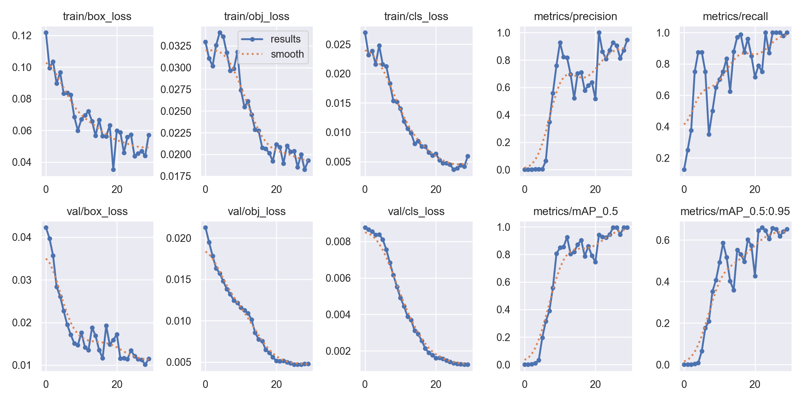
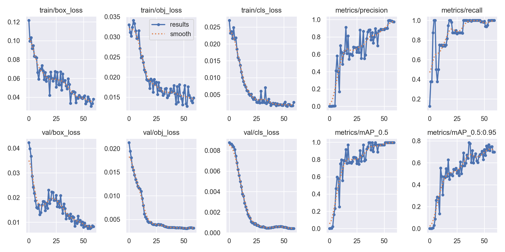

# FIAP - Faculdade de Informática e Administração Paulista
   

 

# 🧠 FarmTech Solutions: O despertar da Rede Neural

## Turma: FIAP-1TIAOB

## 👨‍🎓 Integrantes
- Samyr de Souza Pereira
- Antonio Filipe de Souza Branco
- Albert Oliveira Ribeiro
- Vinicius Seiti Adati

## 👩‍🏫 Professores

### Tutor(a)
- Sabrina Otoni

### Coordenador(a)
- André Godoi Chiovato

## 📜 Descrição

Projeto da **Fase 6 — O começo da rede neural**, desenvolvido para demonstrar aplicações práticas de Visão Computacional.

O projeto utiliza um dataset com imagens de **vacas** e **bicicletas** e foi dividido em duas etapas principais:

- **Entrega 1:** treinamento e avaliação de um modelo YOLOv5 customizado, comparando simulações com 30 e 60 épocas;
- **Entrega 2:** comparação da YOLO customizada com uma **YOLO padrão pré-treinada** e uma **CNN desenvolvida e treinada do zero** para classificação das imagens.

👉 **Notebook completo (Google Colab):**  

🗂️ **Dataset e arquivos no Google Drive:**  
https://drive.google.com/drive/folders/1gz_ejuuDiEIgJNe1DnIa7cBvoya6AeVr?usp=drive_link

O passo a passo da implementação, códigos comentados, saídas, avaliações e conclusões completas estão disponíveis no notebook.

### 🖼️ Dataset

- 80 imagens no total;
- 40 imagens de vacas;
- 40 imagens de bicicletas;
- utilizadas exclusivamente para fins acadêmicos;
- divisão por classe:
  - 32 imagens para treino;
  - 4 para validação;
  - 4 para teste;
- total:
  - 64 imagens de treino;
  - 8 de validação;
  - 8 de teste.

Na Entrega 1, a rotulação foi realizada no **Make Sense AI**, com caixas delimitadoras exportadas no formato YOLO:

- classe 0 = vaca;
- classe 1 = bicicleta.

## 🧠 Metodologia

### Entrega 1 — YOLOv5 customizada

Foi utilizado o modelo pré-treinado `yolov5s` como base para treinamento com as imagens do projeto.

Foram realizadas duas simulações:

- **30 épocas**;
- **60 épocas**.

Os modelos foram avaliados utilizando métricas como:

- precisão;
- recall;
- mAP50;
- mAP50-95;
- perdas de treinamento;
- tempo de treinamento;
- análise visual das imagens de teste.

### Entrega 2 — Comparação de abordagens

A segunda etapa utiliza o mesmo dataset para comparar três soluções:

1. **YOLOv5 customizada**, desenvolvida na Entrega 1;
2. **YOLO padrão**, utilizando o modelo `yolov5s.pt` pré-treinado;
3. **CNN treinada do zero**, criada especificamente para classificar as imagens entre `vaca` e `bicicleta`.

A comparação considera:

- facilidade de uso e integração;
- desempenho do modelo;
- tempo de treinamento ou customização;
- tempo de inferência;
- vantagens e limitações de cada abordagem.

É importante destacar que as abordagens executam tarefas diferentes: a YOLO realiza **detecção e localização de objetos**, enquanto a CNN realiza **classificação da imagem inteira**.

## 📈 Curvas de treino — Entrega 1

Perdas de treinamento e métricas de validação ao longo das épocas.

### 30 épocas

### 60 épocas

## 📊 Resultados do conjunto de teste — Entrega 1

| Métrica | 30 épocas | 60 épocas |
|---|---:|---:|
| Precisão | 0,842 | 0,899 |
| Recall | 0,964 | 0,713 |
| mAP50 | 0,995 | 0,912 |
| mAP50-95 | 0,649 | 0,736 |
| Tempo de treino | 0,177 h | 0,348 h |
| Detecções nas 8 imagens | 7 de 8 | 8 de 8, com 1 caixa duplicada |

## 🔎 Principais achados

### Entrega 1

- Os dois modelos conseguiram aprender a distinguir vacas de bicicletas utilizando apenas 64 imagens de treinamento.
- Não houve um vencedor absoluto entre as simulações de 30 e 60 épocas.
- O modelo de 60 épocas apresentou melhor mAP50-95, mas exigiu maior tempo de treinamento.
- O modelo de 30 épocas apresentou maior recall no conjunto de teste.
- A inspeção visual também mostrou diferenças entre as duas simulações.
- Devido ao pequeno número de imagens de validação e teste, as métricas são sensíveis a poucos erros.

### Entrega 2

A comparação mostrou que cada abordagem possui vantagens diferentes.

- A **YOLO customizada** é a solução mais completa quando é necessário identificar a classe e também localizar o objeto na imagem.
- A **YOLO padrão** possui grande facilidade de integração por utilizar pesos previamente treinados, sem necessidade de novo treinamento para classes já existentes no COCO.
- A **CNN treinada do zero** é uma alternativa mais simples quando o objetivo é apenas classificar a imagem.

Na simulação da CNN utilizando o mesmo conjunto de dados, foram obtidos **7 acertos em 8 imagens de teste**, correspondendo a **87,5% de accuracy**.

As métricas de YOLO e CNN não devem ser comparadas diretamente como se fossem equivalentes, pois `mAP` avalia detecção de objetos, enquanto `accuracy` avalia classificação.

## 📁 Estrutura de pastas

Dentre os arquivos e pastas presentes na raiz do projeto:

- **.github**: arquivos de configuração do GitHub;
- **assets**: imagens e outros arquivos utilizados na documentação;
- **config**: arquivos de configuração do projeto;
- **document**: documentos relacionados ao desenvolvimento;
- **scripts**: scripts auxiliares;
- **src**: notebook principal da Fase 6;
- **README.md**: documentação introdutória e guia do projeto.

## 🔧 Como executar o código

### Pré-requisitos

- Conta Google;
- Google Colab;
- acesso ao Google Drive contendo o dataset;
- ambiente Python com as bibliotecas utilizadas no notebook.

### Execução

1. Abra o notebook pelo botão **Open in Colab** localizado no início deste README.
2. Acesse a pasta compartilhada do Google Drive.
3. Adicione `FarmTech_Fase6` como atalho em **Meu Drive**, caso necessário.
4. No Colab, selecione GPU em:
   **Ambiente de execução > Alterar tipo de ambiente de execução > T4**, quando disponível.
5. Execute as células do notebook em ordem.

O dataset é lido a partir do Google Drive. Os novos arquivos temporários de execução são armazenados em `/content/FarmTech_Fase6_Resultados`, evitando dependência de permissão de escrita na pasta compartilhada do Drive.

## 🎥 Vídeo de demonstração

O vídeo possui duração máxima de **5 minutos** e apresenta o funcionamento e os principais resultados do projeto.

**YouTube (não listado):** https://youtu.be/HBAGA9SWhhw

## 🧪 Limitações

- O dataset possui apenas 40 imagens por classe.
- Os conjuntos de validação e teste contêm somente 8 imagens cada.
- Com apenas 8 imagens de teste, um único erro representa uma alteração de 12,5 pontos percentuais em uma métrica de classificação.
- As imagens não representam todas as possíveis condições reais de uso, como objetos distantes, parcialmente ocultos ou ambientes muito diferentes.
- A YOLO customizada exige rotulação e treinamento específico.
- A YOLO padrão não foi ajustada especificamente para o conjunto de imagens deste projeto.
- A CNN realiza classificação da imagem inteira e não fornece a localização do objeto.
- Durante a etapa final do desenvolvimento houve indisponibilidade temporária de GPU no Google Colab. Por isso, algumas avaliações da Entrega 2 foram conferidas em execução externa utilizando o mesmo dataset e a mesma divisão de treino, validação e teste.

## 🗃 Histórico de lançamentos

### 1.0.0 — Outubro/2026
- Entrega 1:
  - YOLOv5 customizada;
  - treinamentos com 30 e 60 épocas;
  - validação e teste;
  - análise comparativa.

### 2.0.0 — Outubro/2026
- Entrega 2:
  - YOLO padrão;
  - CNN treinada do zero;
  - comparação entre YOLO customizada, YOLO padrão e CNN;
  - avaliação crítica de vantagens, limitações e desempenho.

## 📋 Licença

<a property="dct:title" rel="cc:attributionURL" href="https://github.com/agodoi/template">MODELO GIT FIAP</a> por
<a rel="cc:attributionURL dct:creator" property="cc:attributionName" href="https://fiap.com.br">FIAP</a>
está licenciado sob
<a href="http://creativecommons.org/licenses/by/4.0/?ref=chooser-v1" target="_blank" rel="license noopener noreferrer" style="display:inline-block;">Attribution 4.0 International</a>.

